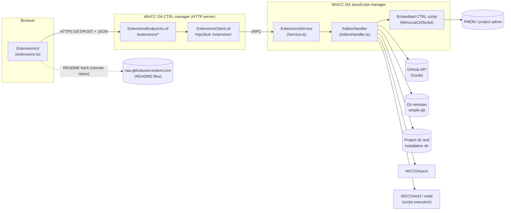
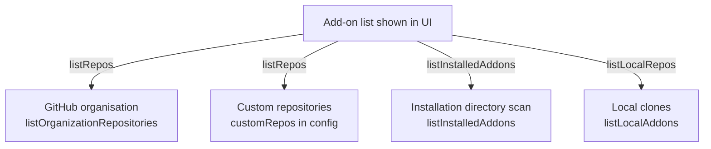
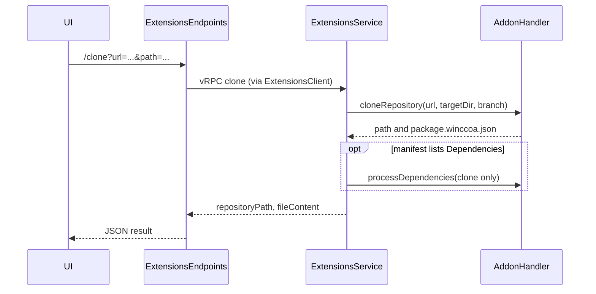
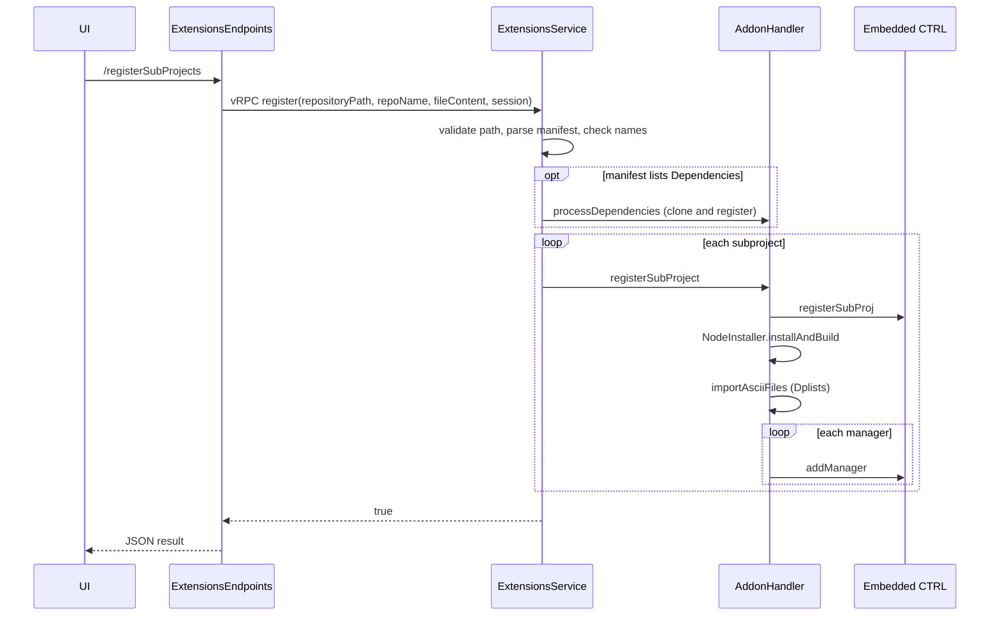
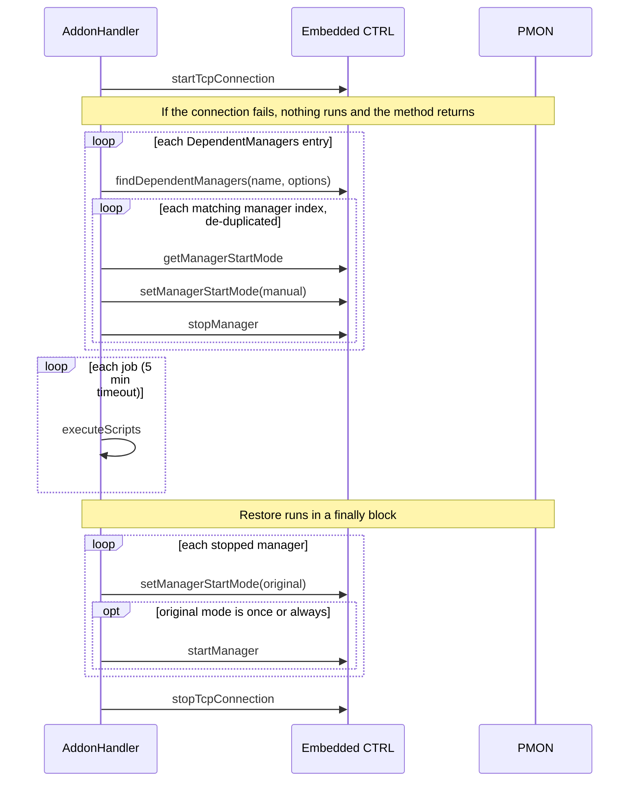

# Architecture and Business Processes

Maintainer overview of the WinCC OA Extensions add-on. It explains how the pieces fit together and what happens
during each user-visible process. For installation, configuration keys and the `package.winccoa.json` schema, see
[README.md](README.md); that information is not repeated here.

Code is referenced by file and symbol name only, because line numbers drift.

## 1. What this project does

The Extensions add-on is a package manager for WinCC OA add-ons. From a web UI a user can:

- **Discover** add-ons: GitHub organisations, custom git URLs, and add-ons shipped inside the WinCC OA installation directory.
- **Download** (clone) an add-on repository into the project directory.
- **Install** (register) it as a WinCC OA subproject, including its dependencies, datapoint lists, managers and Node.js code.
- **Update** it (git pull plus update scripts), **uninstall** it, or **remove** the cloned files.
- Run **DbUpdateScripts** automatically each time the Extensions JavaScript manager starts.

An add-on describes itself with a `package.winccoa.json` manifest in its repository root. Everything the tool does
is driven by that manifest.

## 2. Repository layout

The repository is an npm workspace monorepo. The root `package.json` builds the backend and the frontend.

| Path | Role |
|------|------|
| `winccoa-extensions/data/extensions/` | Browser UI (TypeScript, Siemens IX components): `index.html`, `extensions.ts` (the `ExtensionsUI` class), `init.ts`, `types.d.ts`, `styles.css`. Served by the WinCC OA HTTP server under `/data/...`. |
| `winccoa-extensions/scripts/webclient_http.ctl` | Starts the HTTP server and calls `ExtensionsEndpoints::connectEndpoints`. |
| `winccoa-extensions/scripts/libs/classes/extensions/ExtensionsEndpoints.ctl` | CTRL HTTP endpoints under `/extensions/...`. Translates HTTP query parameters into vRPC calls. |
| `winccoa-extensions/scripts/libs/classes/ExtensionsClient.ctl` | CTRL vRPC stub (`VrpcStub`) for the backend service named `Extensions`. |
| `winccoa-extensions/javascript/winccoa-extensions/index.ts` | Backend entry point (WinCC OA JavaScript manager). |
| `.../lib/Service.ts` | `ExtensionsService`: registers the vRPC functions, parses requests, validates paths. |
| `.../lib/AddonHandler.ts` | `AddonHandler`: all business logic. |
| `.../lib/AddonConfig.ts` | Types for the manifest (`AddonConfig`, `SubprojectConfig`, `ManagerConfig`, `DependentManagerConfig`, `StartMode`). |
| `.../lib/AsciiManager.ts` | Imports datapoint list files by launching the WinCC OA ASCII manager. |
| `.../lib/NodeInstaller.ts` | Runs `npm install` and `tsc` for add-on Node.js code. |
| `.../lib/CommandExecutor.ts`, `CommandResult.ts` | Thin wrapper around `child_process.exec`. |
| `.../lib/PathResolver.ts`, `File.ts` | WinCC OA path and file helpers. |
| `winccoa-extensions/config/extensions.config.json` | Runtime configuration (`authMethods`, `storePath`, `customRepos`). |
| `winccoa-extensions/scripts/run.ctl` | Developer smoke-test script with hard-coded example paths. Not part of the runtime. |

Compiled `*.js` files are git-ignored. Run `npm run build` after checkout; the JavaScript manager starts the built
`index.js`.

## 3. Architecture overview

How to read the diagram: it follows one request from left to right.

- The **browser** only talks to the CTRL HTTP endpoints under `/extensions/*` (GET for almost everything, POST for `setPmonCredentials`). The one exception is the dotted arrow: for remote repositories the UI fetches the README directly from `raw.githubusercontent.com`. Preinstalled add-ons go through `/extensions/readAddonFile` instead.
- The **CTRL manager** hosting the HTTP server has two parts. `ExtensionsEndpoints.ctl` translates HTTP requests, and `ExtensionsClient.ctl` forwards them as vRPC calls to the backend service. Neither contains business logic.
- The **JavaScript manager** receives the vRPC call in `ExtensionsService`, which validates and decodes it and delegates to `AddonHandler`. The handler is the only component that reaches outside the manager:
  - GitHub API through Octokit (listing repositories) and Git remotes through simple-git (clone and pull).
  - The project and installation directories (manifests, cloned repositories, README files).
  - `WCCOAascii` for datapoint list import, and `WCCOActrl` or `node` to run add-on scripts.
  - The embedded CTRL script (`WinccoaCtrlScript`), the only way to reach PMON and project administration (register subprojects, add, start and stop managers).

### Layer responsibilities

| Layer | Responsibility | Does not do |
|-------|----------------|-------------|
| `ExtensionsUI` | State, rendering, user prompts, calling `/extensions/*`. | Never touches the file system or PMON. |
| `ExtensionsEndpoints.ctl` | Maps query parameters to a vRPC request mapping, builds the HTTP status and JSON. Builds `repositoryPath` as `<repoPath>/<repoName>` unless the caller passes `repositoryPath` (installed add-ons). | No validation of the path; that is the Service's job. |
| `ExtensionsService` | Decodes vRPC variants, validates repository paths, parses the manifest | No file or process work itself. |
| `AddonHandler` | Git, GitHub, file system, script execution, dplist import, manager and subproject management. | |
| Embedded CTRL script | Operations only available from CTRL: `paRegProj`, `paSetSubProjs`, `ProjEnvProject`, `pmon_command`. | Holds no business decisions. |

### Embedded CTRL script

`AddonHandler` creates a `WinccoaCtrlScript` from a CTRL source string stored in the class. The JavaScript side
calls its functions by name with `ctrlScript.start(name, args, types)`.

| Function | Purpose |
|----------|---------|
| `registerSubProj` / `unregisterSubProj` | Register a project with `paRegProj` and add it to the subproject list. Unregister it, and call `paDelProj` unless the project must remain registered (preinstalled add-ons). |
| `listSubProjs` | Registered subprojects of the current project. |
| `managerExists` | Find a manager by component name and exact start options. |
| `addManager` | Create a manager through `pmonInsertManager`. If it already exists, reuse it, set its start mode and start it. |
| `restartManager`, `removeManager` | Restart a manager. Remove a manager (set to manual, stop, delete). |
| `findDependentManagers` | Indices of managers matching a component name and an optional glob over start options (`patternMatch`). |
| `getManagerStartMode`, `setManagerStartMode` | Read the start mode. Change it with `SINGLE_MGR:PROP_PUT`, which needs the PMON user and password. |
| `stopManager`, `startManager` | Stop and start by manager index. |
| `startTcpConnection`, `stopTcpConnection` | Open and close the PMON TCP connection held in a global descriptor. |

### Environment resolution

| Value | Resolution order |
|-------|------------------|
| Project directory (`_defaultDirectory`, where repositories are cloned) | `storePath` in `extensions.config.json` (must be an existing directory), then registry key `PROJECTDIR`, then the working directory. |
| WinCC OA installation directory | `winccoa.getPaths()` (last entry), then registry key `INSTALLDIR`, then `PVSS_INSTALL_BASE`. |
| WinCC OA version | `winccoa.getVersionInfo()` at handler construction, used for `OaVersion` compatibility checks. |

### Add-on sources

How to read the diagram: the add-on list in the UI is the combination of four independent sources, each loaded through its own backend call (the edge labels are the UI routes). The GitHub organisation and the custom repositories are returned together by the single `listRepos` call, which concatenates both. The installation directory scan and the local clones are separate calls, and the UI merges all results (see 4.1). The bullets below describe each source.

- **GitHub organisation** (`winccoa` by default, selectable in the UI): paged through Octokit.
- **Custom repositories**: `customRepos` entries from the config.
- **Installed add-ons**: each immediate subdirectory of the installation directory that contains a `package.winccoa.json`, is compatible with the running `OaVersion`, and is not already present in the project directory. They are flagged `installedAddon: true` and `localPath` is the installation directory.
- **Local clones**: each project-directory subfolder with a `package.winccoa.json`. The UI merges these into the list to show clone state, installed version and update availability.

## 4. Business processes

### 4.1 Discover and browse

1. On load the UI fetches the add-on lists in parallel: the selected organisation (plus custom repos), the installation directory scan, local clones and registered subprojects.
2. `extractPackageData` reads `winccoaPackage` and the local manifest to derive the display name (`RepoName`), version, keywords, subprojects and `hasUpdate`.
3. The list is sorted by priority: registered, then update available, then cloned or installed, then not downloaded. The search box and keyword filter act on the display name, name and description.
4. A second mode, "Registered projects", shows only add-ons whose subproject name appears in the registered list.

### 4.2 Download (clone)

How to read the diagram: the UI starts the clone over HTTP and the request travels through the endpoint and the vRPC hop (`ExtensionsClient`, not drawn as its own participant) to `ExtensionsService`. The Service asks `AddonHandler` to clone (or pull, if the folder already exists) and gets back the local path and the manifest content. Only if that manifest lists `Dependencies` does the Service make a second call to clone those repositories, without registering them (the `opt` block). The result (`repositoryPath`, `fileContent`) travels back the same way so the UI can show the add-on as downloaded.

1. The UI shows the target path and asks for confirmation.
2. `cloneRepository` picks the target (default: `<projectDir>/<repoName from URL>`). If the folder exists, it runs `git pull` instead.
3. After cloning it also runs `git pull`, then reads `package.winccoa.json`.
4. The Service parses the manifest and calls `processDependencies(..., registerSubprojects=false)`, which only clones the dependency repositories. Dependency errors here are logged and do not fail the clone.

### 4.3 Install (register subprojects)

How to read the diagram: the Service does the orchestration, the Handler does the work. The `loop each subproject` block is driven by the Service. After the last subproject the Service answers `true`, which the endpoint turns into the JSON response.

1. If the add-on is not cloned and is not a preinstalled add-on, the UI runs the clone flow first.
2. For preinstalled add-ons the UI also sends `repositoryPath` (the installation directory) and `repoName` (the folder name).
3. The Service validates the path, parses the manifest and checks subproject names.
4. `processDependencies` handles each URL in `Dependencies`: clone, read the manifest, recurse into nested dependencies, register that repository's subprojects. A `processedDeps` set prevents cycles and self-dependencies.
5. For each subproject, `registerSubProject` runs these steps in a fixed order: `registerSubProj` in the CTRL script, then `npm install` and `tsc` for every `package.json` below the subproject's `javascript` folder, then the import of each `Dplists` file from the subproject's `dplist` folder, then `addManager` for each entry in `Managers`. If `registerSubProj` fails, the remaining steps for that subproject are skipped.
6. `registerSubProj` skips `paRegProj` if the project is already registered, so re-registering is safe.
7. `addManager` reuses an existing manager with the same component name and options (updates the start mode and starts it) instead of adding a duplicate.

### 4.4 Update (pull)

1. The UI calls `/pull?repoName=...`. The Service validates that the path is a cloned repository.
2. `pullRepository` reads and validates the manifest before the pull (if that fails the method returns without pulling), runs `git pull`, then waits 30 seconds.
3. It re-reads the manifest. The rest of the update runs only if `Version` increased (`isVersionHigher`).
4. Dependencies are processed again (clone and register). Errors there are logged and the update continues.
5. **Phase 0: import dplists.** The `Dplists` of every subproject are imported first, so that `UpdateScripts` can rely on the data point types they provide. Import errors are logged per file and do not stop the update.
6. **Phase 1: update scripts under manager guard.** Every subproject with `UpdateScripts` becomes a script job. The union of all their `DependentManagers` is passed to `runAllScriptsGuardedByManagers` (see 4.7).
7. **Phase 2: post-processing per subproject.** In order:
   1. Run `NodeInstaller.installAndBuild`.
   2. Remove managers that existed in the old manifest and are gone from the new one (matched by name and options).
   3. For each manager in the new manifest: if it exists and `RestartOnUpdate` is set, restart it; otherwise call `addManager`, which creates it or reuses an existing one.
8. Errors during the post-pull processing are caught and logged. The method still returns a result so the UI can reload the new manifest.

### 4.5 Uninstall (unregister)

1. The UI asks for confirmation. For cloned repos it offers a checkbox to also delete the files. For preinstalled add-ons that checkbox is hidden and `deleteFiles` is always `false`.
2. The Service validates the path, parses the manifest and calls `unregisterSubProject` for each subproject.
3. `unregisterSubProject` first runs the subproject's `UninstallScripts` (5-minute timeout, failures are logged and do not stop the uninstall).
4. If the path is the installation directory, the project stays registered in project administration (`remainRegistered`) and file deletion is refused. Otherwise `unregisterSubProj` removes the subproject from the current project and calls `paDelProj`.
5. If `deleteFiles` is true and the path is a direct child of the project directory, the repository folder is removed.
6. The endpoint's `deleteFiles` default is `false`. Deletion must be requested explicitly.

### 4.6 Remove (delete clone)

`/remove?repoName=...` resolves `<repoPath>/<repoName>`. The Service accepts only cloned repositories. `removeRepository` refuses any path that is not a direct child of the project directory, then removes the folder recursively.

### 4.7 Scripts and dependent managers

`executeScripts(dir, scripts)` dispatches by file extension:

| Extension | Execution |
|-----------|-----------|
| `.ctl`, `.ctc` | `WCCOActrl -currentproj "<dir>/scripts/<file>"`. Falls back to the bare filename if the file is not in `scripts/`. |
| `.js` | `node.exe "<install>/javascript/winccoa-manager/lib/bootstrap.js" -currentproj "<dir>/javascript/<file>"`. |
| `.ts` | Runs `installAndBuild` first, then runs the matching `.js` as above. |
| other | Warning and skipped. |

Each script runs in a try/catch that only logs, so one failing script does not stop the others.

`runAllScriptsGuardedByManagers(jobs, dependentManagers, user, password, fatalOnError)` wraps a set of jobs:

How to read the diagram: it has four phases, top to bottom. The calls to `C` end up as PMON commands (participant `P`) over the TCP connection opened in the first step.

1. **Connect.** `startTcpConnection` opens the PMON connection used by all following calls. If it cannot be opened, the whole guarded run is skipped.
2. **Stop.** For every `DependentManagers` entry the handler finds the matching managers, remembers each one's start mode, sets it to manual (so PMON does not restart it) and stops it. Managers that fail to stop are not recorded and are never touched again.
3. **Run.** The jobs run one after another, each with a 5-minute timeout. A failing or timed-out job is logged and the next job still runs.
4. **Restore.** For each stopped manager the original start mode is written back, and the manager is started again if that mode was `once` or `always`. Finally the TCP connection is closed.

- Matching managers are de-duplicated by index and restored in index order.
- Restoration is in a `finally`, so it runs even when scripts fail or time out.
- With `fatalOnError`, the first collected script error is rethrown after restoration. The update flow uses `true`, the startup flow uses `false`.
- The PMON user and password are the ones stored for the request's `session`.

### 4.8 Startup DbUpdateScripts

Triggered from `index.ts` (`extensionsService.runStartupTasks()`) after the service is up, each time the JavaScript manager starts.

1. `_discoverAllAddons` merges local clones and installed add-ons. Preinstalled add-ons default their subproject name to the folder name.
2. It keeps only subprojects that define `DbUpdateScripts`, have a name, and are currently registered (`listSubProjects`).
3. It builds one job per subproject and the union of their `DependentManagers`.
4. It runs the guarded flow from 4.7 with empty PMON credentials and `fatalOnError=false`. Errors are logged and never stop the service from running.

## 5. Frontend notes

`extensions.ts` contains one large class, `ExtensionsUI`.

- **Repository state flags:** `cloned`, `installedAddon`, `localPath`, `fileContent` (local manifest), `currentVersion`, `latestVersion`, `hasUpdate`, `loadingAction` (`download`, `update`, `install`, `uninstall`, `remove`).
- **Button availability** (in `updateLocalStatus`):
  - Not downloaded: only download and install.
  - Cloned: update only when `hasUpdate`; install; remove.
  - Registered: uninstall and update.
  - Preinstalled (`installedAddon`): install and uninstall only. Download, update and remove are disabled.
- **Loading state** is set per repository (`setRepositoryLoading`) so switching repos during an operation does not mix state.
- **Detail view:** one tab per subproject. Cards show managers, dplists, dependent managers, update, uninstall and DB update scripts.
- **README rendering:** GitHub README for remote repos. For preinstalled add-ons it goes through `/extensions/readAddonFile`, which reads from disk on the backend.
- **IX modals** (`ixShowMessage`, `ixShowUnregisterConfirm`, `ixShowDeleteConfirm`) are defined in `index.html`.

## 6. Extension recipes

### Add a new backend function

1. Add the method in `ExtensionsService` and register it in the constructor with `registerFunction`.
2. Add the matching call in `ExtensionsClient.ctl`.
3. Add the endpoint in `ExtensionsEndpoints.ctl` and register it in `connectEndpoints` with `httpConnect`.
4. Call it from `extensions.ts` through `makeApiCall`.
5. If it accepts a path, validate it in the Service with `validateRepositoryPath`.

### Add a manifest key

1. Add it to the interfaces in `AddonConfig.ts`.
2. Map it in `AddonHandler.mapPackageJsonToAddonConfig` (default optional arrays to `[]`).
3. Consume it in the relevant flow (register, pull, unregister or startup).
4. Show it in `renderSubprojectCards` in the frontend and pass it through `getSubprojects`.
5. Document it in the README field reference.

### Add a CTRL helper to the embedded script

Edit the template string in `AddonHandler`. Call it with `this.ctrlScript.start(name, args, types)` and make sure the
types array matches the CTRL signature one for one.

## 7. Glossary

| Term | Meaning |
|------|---------|
| Add-on / extension | A repository with a `package.winccoa.json` manifest. |
| Subproject | A WinCC OA project registered as a subproject of the current project. One add-on can contain several. |
| Preinstalled add-on | An add-on found in the WinCC OA installation directory. It is a subproject itself and is never deleted from disk. |
| Dependent manager | A running manager that must be stopped while update or DB update scripts run, then restored. |
| DbUpdateScripts | Scripts run at every start of the Extensions JavaScript manager. |
| UpdateScripts | Scripts run after a successful pull with a higher `Version`. |
| PMON | The WinCC OA process monitor. It starts, stops and configures managers. |
| vRPC | WinCC OA's service-to-service RPC, used between CTRL and the JavaScript manager. |
| `ProjEnv` | WinCC OA CTRL library (`ProjEnvProject`) used to read and control managers and the project. |
